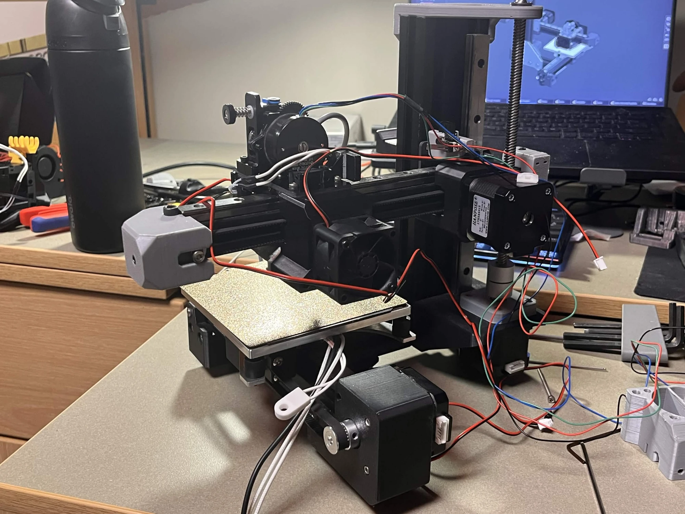
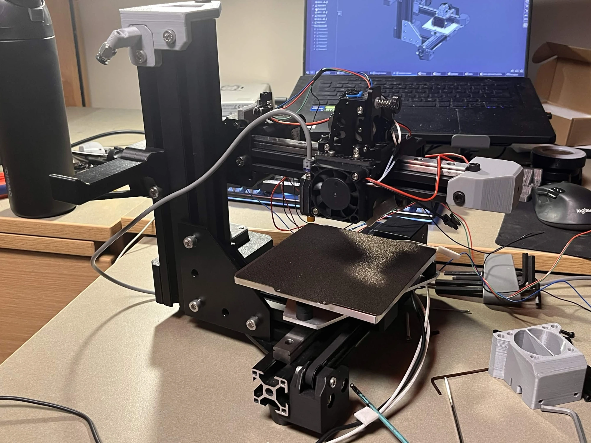
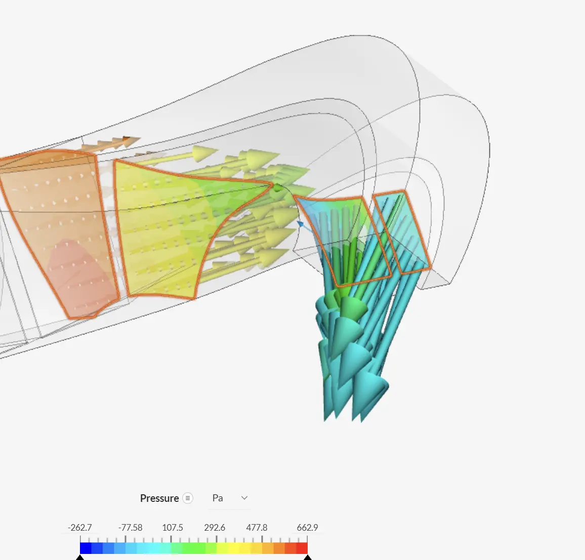
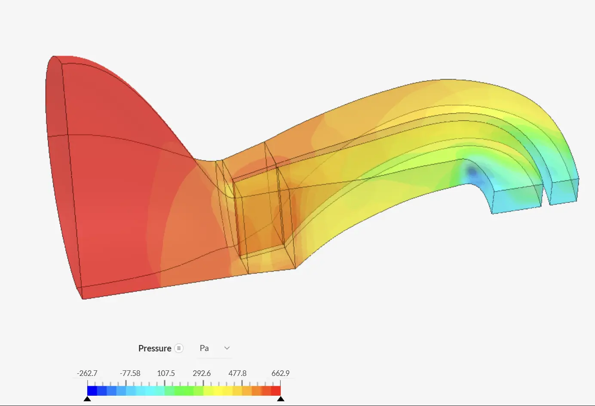
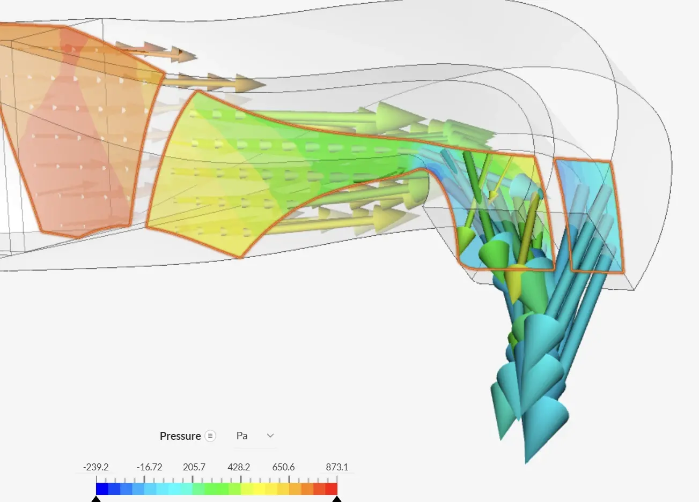
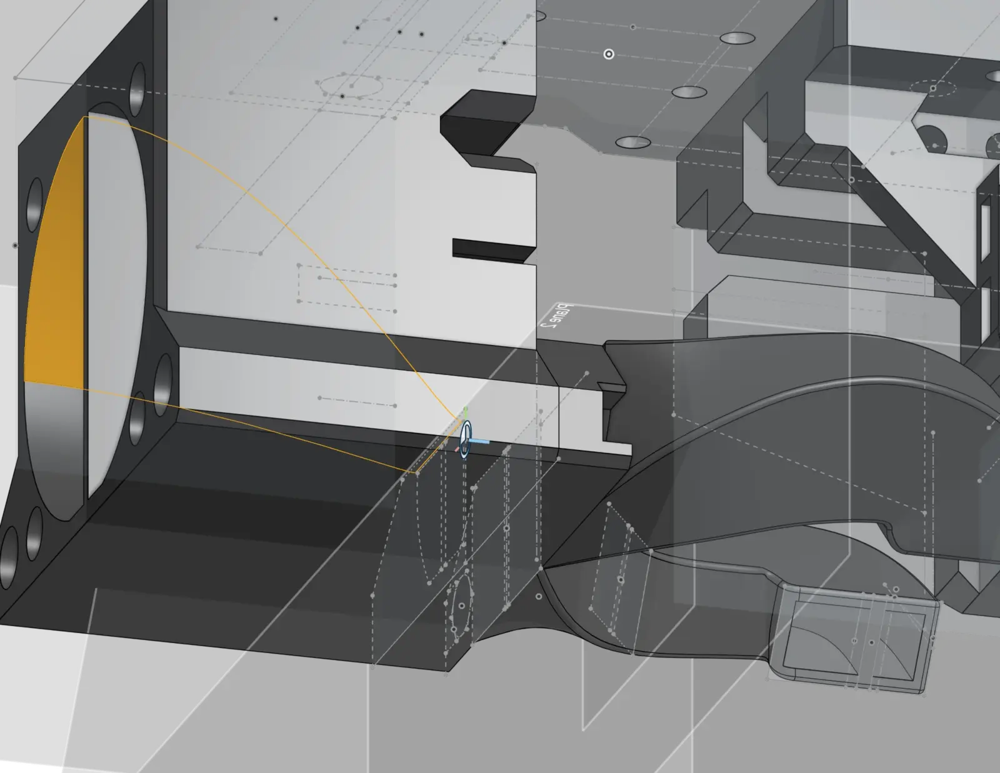
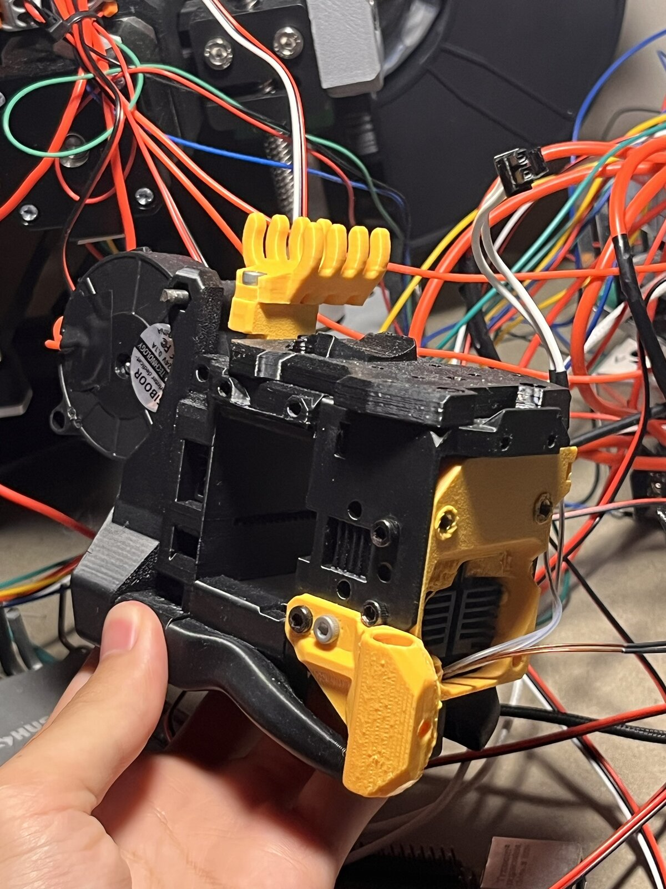
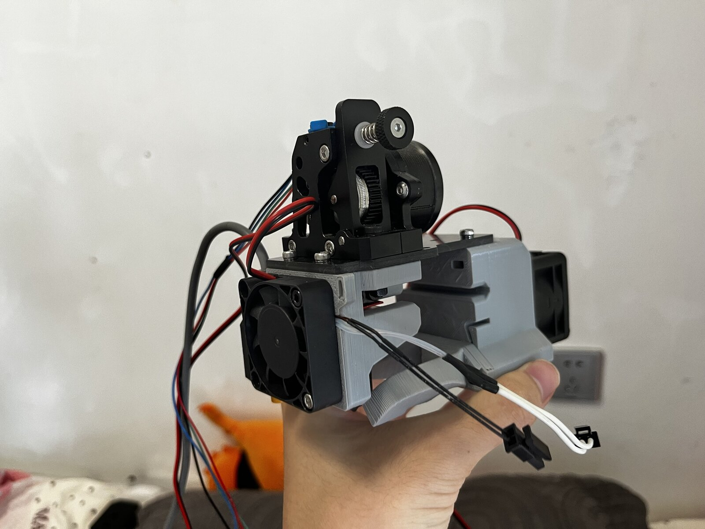

<video style="width: 100%; height: auto; aspect-ratio: 1920 / 1080; display: block;" autoplay muted loop playsinline controls preload="metadata">
<source src="images/MicrosoftTeams-video.mp4" type="video/mp4">
</video>

Printer in action

CAD

Real Life Images

<h2 id="design-process">Design Process</h2>

Left: low pressure output. Second: original design, high backpressure causing airflow to spill out the back, also tested in real life. Third: optimized design with increased pressure, smoothed out corners and reduced rapid geometry changes. Right: duct CAD.

Left: open source toolhead design. Right: custom design, lighter, faster feeding reaction speed, more cooling output, smaller footprint.

<a href="/" class="back-home" style="display: inline-block; padding: 8px 16px; border: 1px solid #ccc; border-radius: 6px; text-decoration: none;">&larr; Back to main page</a>
