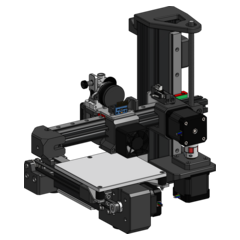
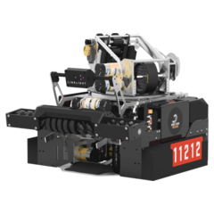
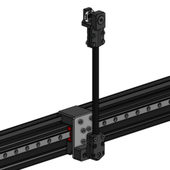
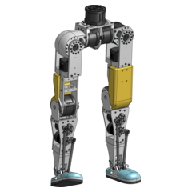
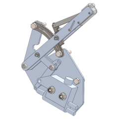
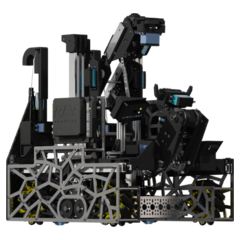

# Randy Li | Mechanical Engineer

<a href="https://www.linkedin.com/in/randy-li-96a6a43ba/" style="display: inline-flex; align-items: center; gap: 6px; text-decoration: none;">LinkedIn</a>
Posting my projects on social media:
<a href="https://www.instagram.com/randyl.builds/" style="display: inline-flex; align-items: center; gap: 6px; text-decoration: none;">Instagram</a>
<a href="https://x.com/Procat3rd" style="display: inline-flex; align-items: center; gap: 6px; text-decoration: none;">X</a>
<a href="mailto:li.randyjiang@gmail.com" style="display: inline-flex; align-items: center; gap: 6px; text-decoration: none; margin-top: 6px;">li.randyjiang@gmail.com</a>

## About Me
Mechanical engineering at UW-Madison, passionate about all things robotics, racing and automation.

## Projects

<h3 id="custom-3d-printer">Custom 3D Printer</h3>

120x120mm bed size cantilevered bed slinger

<a href="3dprinter.html" style="display: inline-block; padding: 8px 16px; border: 1px solid #ccc; border-radius: 6px; text-decoration: none;">View project &rarr;</a>

<h3 id="first-tech-challenge-robot-2025-2026">FIRST Tech Challenge Robot 2025-2026</h3>

Competition robot designed to launch balls into a goal and intake balls off of the ground

<a href="decode.html" style="display: inline-block; padding: 8px 16px; border: 1px solid #ccc; border-radius: 6px; text-decoration: none;">View project &rarr;</a>

<h3 id="inverted-pendulum-cart">Inverted Pendulum Cart</h3>

Balancing of a lightweight carbon fiber pendulum on an mgn rail cart driven by a brushless motor

<a href="pendulum.html" style="display: inline-block; padding: 8px 16px; border: 1px solid #ccc; border-radius: 6px; text-decoration: none;">View project &rarr;</a>

<h3 id="wisconsin-humanoids">Wisconsin Humanoids</h3>

Legs engineer, working on a full redesign of the legs, ankle and shin subsystems

<a href="humanoids.html" style="display: inline-block; padding: 8px 16px; border: 1px solid #ccc; border-radius: 6px; text-decoration: none;">View project &rarr;</a>

<h3 id="badger-solar-racing">Badger Solar Racing</h3>

Brakes engineer, working on a parking brake redesign, optimization of brake system and various other parts

<a href="racing.html" style="display: inline-block; padding: 8px 16px; border: 1px solid #ccc; border-radius: 6px; text-decoration: none;">View project &rarr;</a>

<h3 id="first-tech-challenge-robot-2024-2025">FIRST Tech Challenge Robot 2024-2025</h3>

Competition robot designed to pick up blocks and place into baskets and suspend itself

<a href="itd.html" style="display: inline-block; padding: 8px 16px; border: 1px solid #ccc; border-radius: 6px; text-decoration: none;">View project &rarr;</a>

CAD image coming soon

<h3 id="microduck-clone">Microduck Clone</h3>

Work in progress, microduck size bipedal robot that can pick up cans off the ground (hopefully) 

<a href="microduck.html" style="display: inline-block; padding: 8px 16px; border: 1px solid #ccc; border-radius: 6px; text-decoration: none;">View project &rarr;</a>

