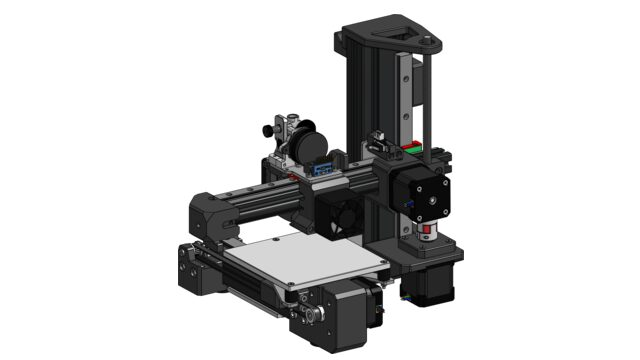
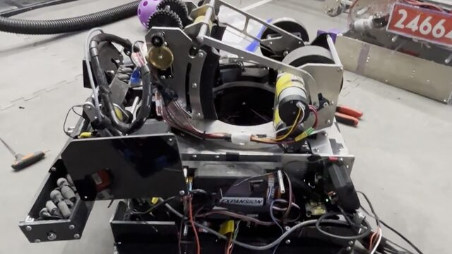
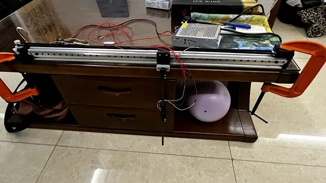

# Randy Li | Mechanical Engineer
[LinkedIn](https://www.linkedin.com/in/randy-li-96a6a43ba/)

## About Me
Mechanical engineering at UW-Madison, passionate about all things robotics, racing and automation.

## Projects

### Custom 3D Printer
120x120mm bed size cantilevered bed slinger

<a href="3dprinter.html" style="display: inline-block; padding: 8px 16px; border: 1px solid #ccc; border-radius: 6px; text-decoration: none;">View project &rarr;</a>

### FIRST Tech Challenge Robot 2025-2026
Competition robot designed to launch balls into a goal and intake balls off of the ground (lead mechanical engineer)

<a href="decode.html" style="display: inline-block; padding: 8px 16px; border: 1px solid #ccc; border-radius: 6px; text-decoration: none;">View project &rarr;</a>

### Inverted Pendulum Cart
Balancing of a lightweight carbon fiber pendulum on an mgn rail cart driven by a brushless motor

<a href="pendulum.html" style="display: inline-block; padding: 8px 16px; border: 1px solid #ccc; border-radius: 6px; text-decoration: none;">View project &rarr;</a>

### UW Madison Racing
New member, working on a parking brake redesign, optimization of brake system and various other parts

<a href="racing.html" style="display: inline-block; padding: 8px 16px; border: 1px solid #ccc; border-radius: 6px; text-decoration: none;">View project &rarr;</a>

### FIRST Tech Challenge Robot 2024-2025
Competition robot designed to pick up blocks and place into baskets and suspend itself

<a href="itd.html" style="display: inline-block; padding: 8px 16px; border: 1px solid #ccc; border-radius: 6px; text-decoration: none;">View project &rarr;</a>
