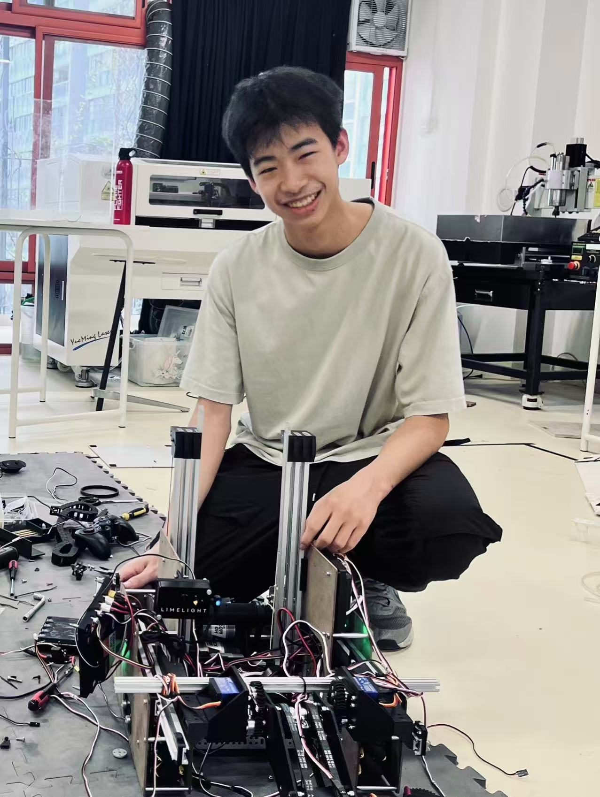

# Randy Li | Mechanical Engineer
[LinkedIn](https://www.linkedin.com/in/randy-li-96a6a43ba/)

## About Me
Mechanical engineering at UW-Madison, passionate about all things robotics, racing and automation.

## Projects

### Custom 3D Printer 
120x120mm bed size cantilevered bed slinger
[images](3dprinter.md)

### FIRST Tech Challenge Robot 2025-2026
Competition robot designed to launch balls into a goal and intake balls off of the ground (lead mechanical engineer) 
[images](decode.md)

### Inverted Pendulum Cart 
Balancing of a lightweight carbon fiber pendulum on an mgn rail cart driven by a brushless motor 
[images / videos](pendulum.md)

### UW Madison Racing
New member, working on a parking brake redesign, optimization of brake system and various other parts
[images](racing.md)

### FIRST Tech Challenge Robot 2024-2025
Competition robot designed to pick up blocks and place into baskets and suspend itself
[images](itd.md)

