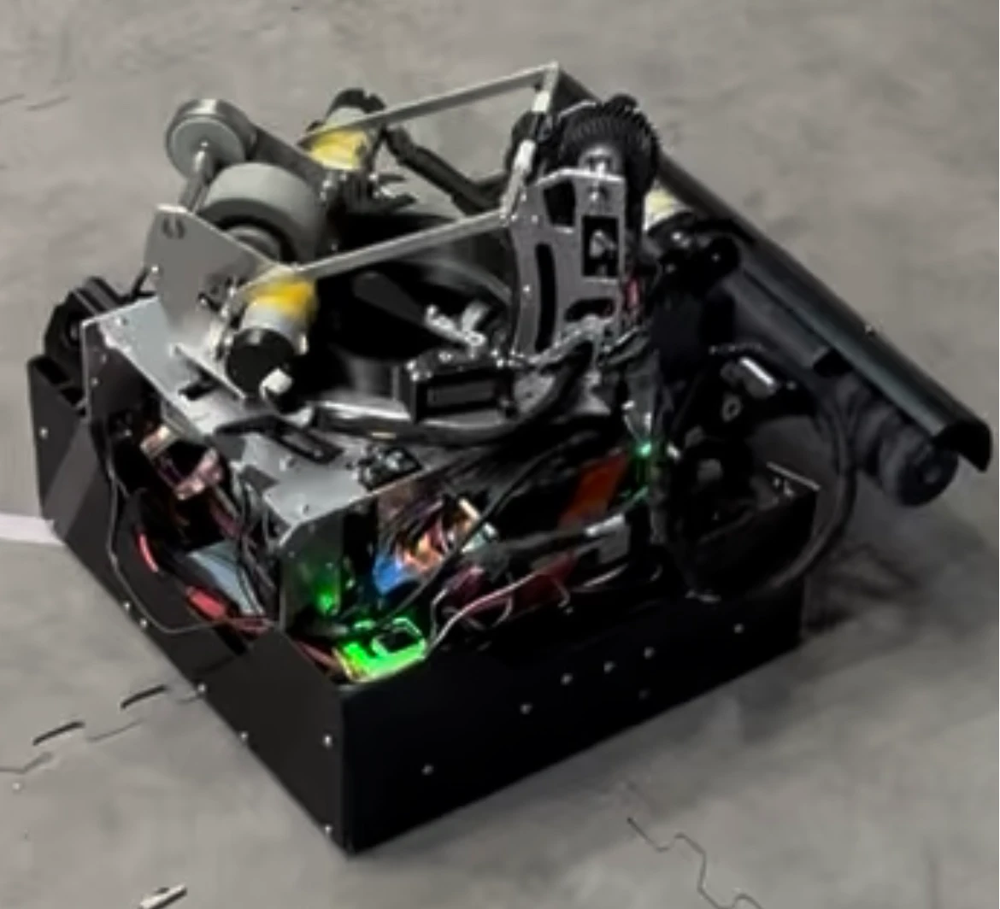

<video style="width: 100%; height: auto; aspect-ratio: 1080 / 1920; display: block;" autoplay muted loop playsinline controls preload="metadata">
<source src="images/IMG_3791.mp4" type="video/mp4">
</video>

Robot self ascension driven by servo motors

<video style="width: 100%; height: auto; aspect-ratio: 1920 / 1080; display: block;" autoplay muted loop playsinline controls preload="metadata">
<source src="images/IMG_3830.mp4" type="video/mp4">
</video>

robot in action

Final (World Championship! April)

Prepping for Regionals (Second Major Iteration) (March)

First Major Iteration (December)

<a href="/" style="display: inline-block; padding: 8px 16px; border: 1px solid #ccc; border-radius: 6px; text-decoration: none;">&larr; Back to main page</a>

