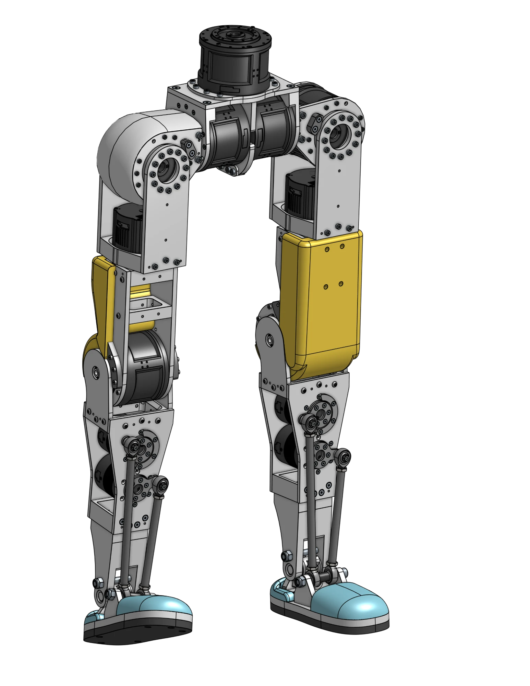
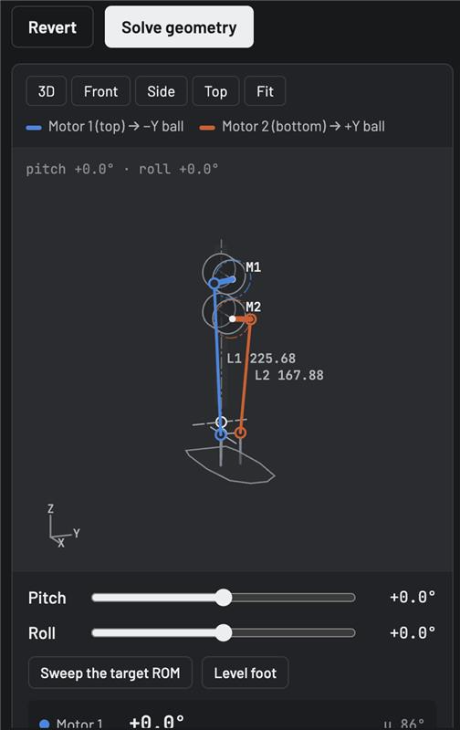
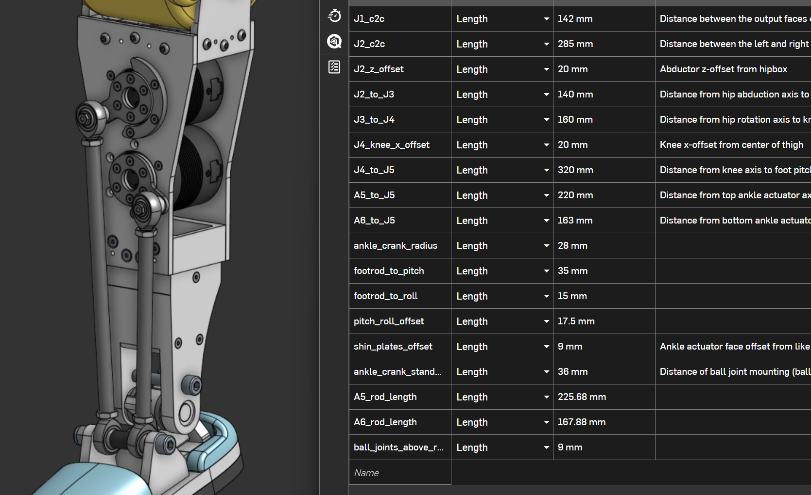

Full CAD assembly

Inverse kinematic parallel ankle solver

Parametricized ankle geometry

<a href="/" style="display: inline-block; padding: 8px 16px; border: 1px solid #ccc; border-radius: 6px; text-decoration: none;">&larr; Back to main page</a>

