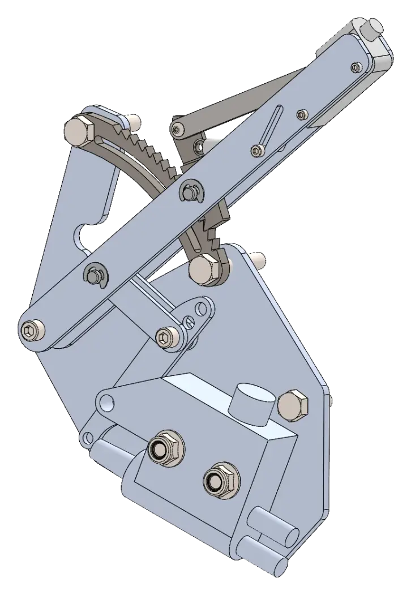
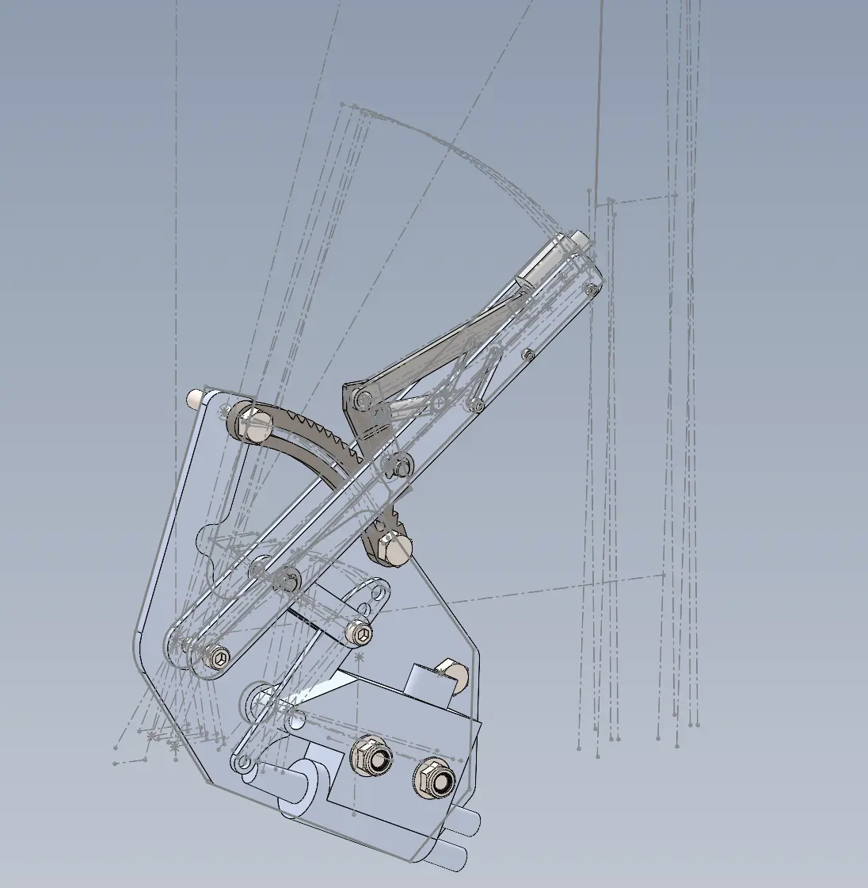

Parking brake redesign, Fall 2026 (button actuation, new master cylinder, double linkage)

Parametric CAD based off master sketch for fast iteration

Optimized clevis part

<h2 id="design-process">Design Process</h2>

<a href="/" class="back-home" style="display: inline-block; padding: 8px 16px; border: 1px solid #ccc; border-radius: 6px; text-decoration: none;">&larr; Back to main page</a>
